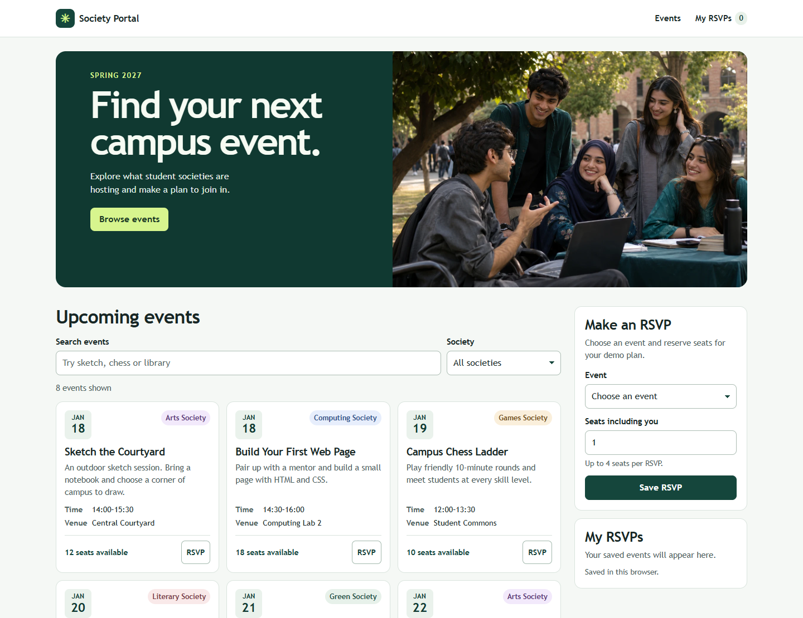

# Student Society Activity Portal

**Web Engineering · Assignment 1 · Idea 08**

A client-side portal for students to discover society events and save a personal RSVP plan. Find an event by searching or choosing a society, select **RSVP**, choose a seat count, then save. **My RSVPs** shows saved events and lets you remove them.

- **Live demo** [Open the portal on GitHub Pages](https://urcoderadil.github.io/student-society-activity-portal/)
- **Source** [View the GitHub repository](https://github.com/UrCoderAdil/student-society-activity-portal)
- **Instructor rule or data variant** Pending. The demo uses a four-seat limit and rejects overlapping events. These demo decisions do not represent a confirmed instructor rule.

## Run locally

Install Git and Python 3, then run these commands in PowerShell. You can also download the repository ZIP, extract it and start the server from the extracted folder.

```powershell
git clone https://github.com/UrCoderAdil/student-society-activity-portal.git
Set-Location student-society-activity-portal
py -3 -m http.server 8000 --bind 127.0.0.1
```

Open [http://127.0.0.1:8000/](http://127.0.0.1:8000/). Press `Ctrl+C` to stop the server. The app uses semantic HTML, CSS and vanilla JavaScript. It has no install, build, API, database or environment variable step.

## How the portal works

| Part | Implementation |
| --- | --- |
| Events | Eight fictional records in `events.js`, sorted by date and start time. Each record has a unique ID, society, time interval, venue and demo seat limit. |
| Directory | `app.js` listens for search and society changes. It combines both filters, updates the result count and displays a no-results state when needed. |
| RSVP | Native form validation checks the event selection and a whole seat count from 1 to 4. JavaScript checks sold-out events, insufficient capacity, duplicates and overlapping time intervals. |
| Persistence | The browser stores only event IDs and seat counts in `localStorage`. The plan survives a reload in the same browser and site, with a temporary fallback when storage is blocked. Capacity is demo data and RSVPs are personal to the browser. |
| Responsive design | The event grid uses one column below 640 px, two from 640 px, and three from 1100 px. Flexbox lays out the filters. At 1100 px the RSVP panel sits beside the directory. |
| Accessibility | The page uses headings, landmarks, visible form labels, a skip link, visible keyboard focus and live feedback for filter and RSVP results. |
| Hosting | GitHub Pages serves static HTML, CSS, JavaScript and the image. The browser handles all filters, validation and saved state. |

## Demo walkthrough

1. Search `library` and choose **Literary Society**. Both controls apply at once. Clear them to restore all eight records.
2. Open **Sketch the Courtyard**, enter `2` seats and save. The event appears under **My RSVPs** and the count increases.
3. Try to save the same event again. Then try **Build Your First Web Page**, which overlaps the saved event. The form explains each result.
4. Select **Campus Plant Walk** and request `4` seats to test capacity. Select **Poster Design Studio** to test the full-event message. Enter `0` for the seat count to see browser validation.
5. Reload to check that a saved RSVP persists. Remove it from **My RSVPs** and confirm it stays removed after reload.

For a small live change, open `events.js`, change the venue for **Campus Chess Ladder**, then reload and search for the new venue. The change flows from the data array through filtering and card rendering.

## Screenshots and design note

The [Word design note](docs/Assignment%201%20Design%20Note.docx) includes the wireframe, web development lifecycle, client and server responsibilities, verified browser checks and six captures from the live site.



[Tablet with two filtered results](screenshots/tablet-filter.png) · [Mobile with stacked controls](screenshots/mobile.png) · [Saved RSVP](screenshots/rsvp-saved.png) · [Conflict feedback](screenshots/rsvp-conflict.png) · [No matching events](screenshots/no-matches.png)

## Deployment

GitHub Pages publishes `main` from the repository root. Keep `index.html` at the root and use relative asset URLs. After a push, check the **Pages build and deployment** workflow and open the site URL in **Settings → Pages**. [GitHub Pages publishing documentation](https://docs.github.com/en/pages/getting-started-with-github-pages/configuring-a-publishing-source-for-your-github-pages-site)

## AI assistance and attribution

I used OpenAI Codex to build the portal, create eight fictional events, test the app, and write the documentation. I used OpenAI ImageGen for the campus photo.

<details>
<summary>Campus photograph generation</summary>

Asset `assets/campus-societies.webp`, generated with the built-in ImageGen tool.

> Create a realistic editorial photograph for the right half of a student society events portal hero. Wide 3:2 horizontal photograph, camera close at human eye height. A candid moment of five Pakistani university-age students at an informal outdoor student society club fair table, chatting and smiling naturally, one woman in a navy hijab and others in understated modern campus clothing. Warm late-afternoon light, tree-lined university courtyard, brick academic building lightly blurred, naturally different expressions, graphite and teal clothing accents, professionally photographed with restrained colors and rich natural shadows. Composition has the group in the center-right, with the left crop showing more soft tree shade. No writing, posters with readable text, logos, labels or watermarks. The group and their hands look natural. Photo only.

</details>
